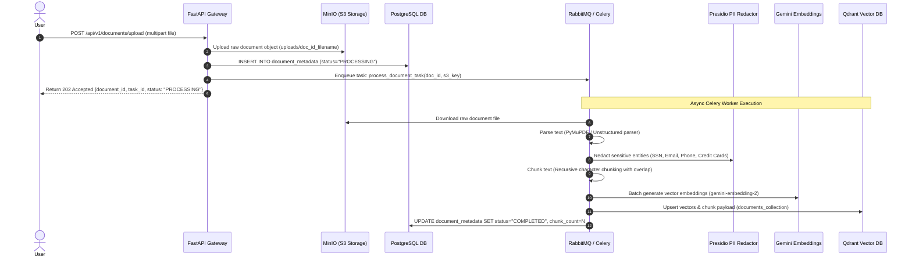

# Enterprise RAG System Architecture: Complete Flow & Lifecycle Guide

This document details the exact end-to-end data pipelines for **Document Ingestion**, **User Question / RAG Querying**, **Data Storage Strategy**, and **Observability & Monitoring**.

---

## 🏗️ 1. Document Ingestion Pipeline Flow



### Detailed Ingestion Steps:
1. **Upload Request**: The client sends a file via `POST /api/v1/documents/upload`.
2. **Object Storage**: The raw file is written to MinIO S3 bucket `rag-documents`.
3. **Database Registration**: Initial row created in PostgreSQL `document_metadata` with status `PROCESSING`.
4. **Queue Offloading**: A background task `process_document_task` is dispatched to RabbitMQ.
5. **Text Extraction & Sanitization**: Celery worker parses text from PDF/TXT/MD, runs Presidio PII redaction, and splits text into overlapping chunks.
6. **Embedding & Vector Storage**: Chunks are embedded using Google Gemini (`gemini-embedding-2`) and stored in Qdrant with metadata payload (document ID, chunk index, text content).
7. **Completion Update**: PostgreSQL status is updated to `COMPLETED`.

---

## ⚡ 2. User Question / RAG Query Flow

```mermaid
sequenceDiagram
    autonumber
    actor User
    participant Gateway as FastAPI Gateway / Middleware
    participant Presidio as PII & Guardrails
    participant Cache as Redis Semantic Cache
    participant Qdrant as Qdrant Vector DB
    participant BM25 as BM25 Keyword Search
    participant Reranker as Cross-Encoder Reranker
    participant LLM as Groq / Gemini LLM
    participant Audit as Postgres Audit Logger

    User->>Gateway: POST /api/v1/chat/query {"query": "..."}
    Gateway->>Gateway: Authenticate JWT & Apply Rate Limiter (Redis)
    Gateway->>Presidio: Scrub PII & validate Prompt Injection Guardrail
    Gateway->>Cache: Lookup query hash / embedding in Redis
    
    alt Cache Hit
        Cache-->>Gateway: Return cached answer & sources
    else Cache Miss
        Gateway->>Qdrant: Vector Search (Dense Embedding Similarity)
        Gateway->>BM25: Sparse Keyword Search
        Gateway->>Gateway: Reciprocal Rank Fusion (RRF) merge
        Gateway->>Reranker: Cross-Encoder Rerank top candidate chunks
        Gateway->>Gateway: Confidence Gate check (threshold filter)
        Gateway->>LLM: Generate grounded response with citations
        LLM-->>Gateway: Generated Answer Text
        Gateway->>Cache: Store (Query -> Answer) in Redis
    end

    Gateway-->>User: Return {answer, sources, confidence_score}
    Gateway-->)Audit: Async log execution time, user_id, status_code to PostgreSQL
```

---

## 💾 3. How Data is Stored Across Systems

| Service | Data Stored | Access Pattern / Schema |
| :--- | :--- | :--- |
| **PostgreSQL** | Relational metadata & audit trails | • `document_metadata`: File sizes, S3 keys, chunk counts, processing statuses.<br/>• `audit_logs`: Endpoint latency, user IDs, client IPs, response status codes. |
| **MinIO (S3)** | Raw document files | Object key pattern: `uploads/{document_id}_{filename}` stored in bucket `rag-documents`. |
| **Qdrant** | Dense vectors & chunk payload | Collection: `documents_collection`<br/>• **Vector**: High-dimensional embedding.<br/>• **Payload**: `{"document_id": "...", "chunk_text": "...", "chunk_index": 0}`. |
| **Redis** | In-memory cache & state | • **Rate Limiting**: Sliding window request timestamps per user.<br/>• **Semantic Cache**: Query hashes and cached responses.<br/>• **Celery Broker State**: Task result metadata. |

---

## 📊 4. How the System is Logged and Monitored

```
                    ┌─────────────────────────┐
                    │   FastAPI Application   │
                    └────────────┬────────────┘
                                 │
         ┌───────────────────────┼───────────────────────┐
         │ (Audit Middleware)    │ (Prometheus Client)   │ (OTel SDK)
         ▼                       ▼                       ▼
┌─────────────────┐    ┌──────────────────┐    ┌──────────────────┐
│ PostgreSQL DB   │    │  /metrics (8000) │    │  OTel Collector  │
│  (audit_logs)   │    └────────┬─────────┘    └────────┬─────────┘
└─────────────────┘             │                       │
                                ▼                       ▼
                       ┌──────────────────┐    ┌──────────────────┐
                       │    Prometheus    │    │  Tempo / Loki    │
                       └────────┬─────────┘    └────────┬─────────┘
                                │                       │
                                └───────────┬───────────┘
                                            ▼
                                 ┌─────────────────────┐
                                 │  Grafana Dashboard  │
                                 │  (http://localhost) │
                                 └─────────────────────┘
```

### 1. Audit Logging (PostgreSQL `audit_logs`)
- Every HTTP request passes through `AuditLoggerMiddleware`.
- Asynchronously records: `user_id`, `trace_id`, `endpoint`, `method`, `status_code`, `ip_address`, `execution_time_ms`, and `timestamp`.
- Non-blocking execution prevents audit writes from slowing down user responses.

### 2. Prometheus Metrics (`/metrics` endpoint)
- Exposes real-time system gauges, counters, and histograms:
  - `rag_requests_total`: Counts requests by method, endpoint, and status code.
  - `rag_query_duration_seconds`: Histogram measuring query processing latency.
  - `rag_cache_hits_total` & `rag_cache_misses_total`: Tracks semantic cache efficiency.
  - `rag_celery_pending_tasks`: Gauge monitoring document processing queue backlogs.

### 3. OpenTelemetry Distributed Tracing (Tempo & Loki)
- Every incoming request generates a unique `trace_id`.
- Tracing context propagates across FastAPI routing, Qdrant vector retrieval, LLM API invocation, and Celery background workers.
- Traces are exported to Tempo, and container logs are collected by Loki.

### 4. Grafana Dashboards (`http://localhost:3000`)
- Aggregates Prometheus metrics, Tempo traces, and Loki logs into a single interface.
- Provides real-time visual graphs for **P95/P99 Latency**, **Request Throughput**, **Error Rates**, **Cache Hit Ratios**, and **Worker Task Queues**.
