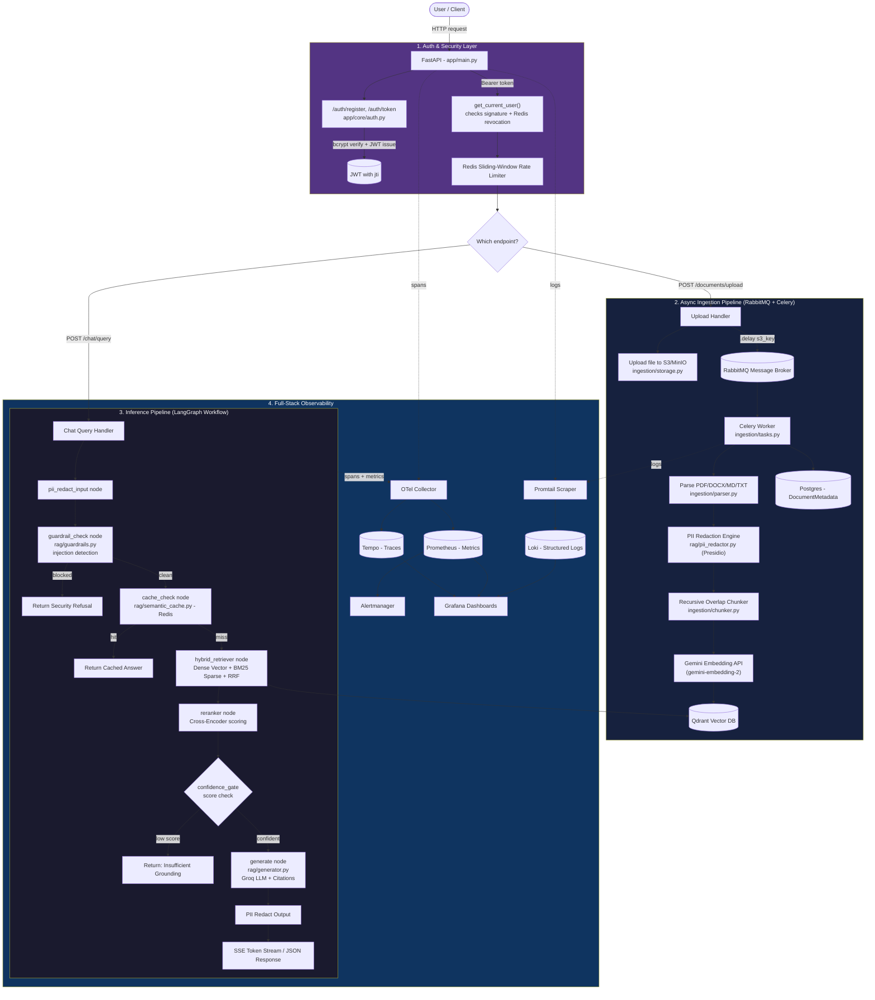

# 🛡️ Enterprise Production RAG System

[](.github/workflows/ci.yml)
[](pyproject.toml)
[](https://fastapi.tiangolo.com)
[](https://qdrant.tech)
[](https://www.postgresql.org)
[](https://redis.io)
[](https://grafana.com)
[](LICENSE)

An enterprise-ready, mission-critical **Retrieval-Augmented Generation (RAG)** platform engineered for high-throughput, low-latency, and compliance-sensitive generative AI workflows. Built with an asynchronous microservice architecture, multi-stage hybrid retrieval, automated PII scrubbing, prompt injection guardrails, and enterprise observability.

> 📖 **Architecture & Deep Dive Documentation**:
> - [ARCHITECTURE_FLOW.md](ARCHITECTURE_FLOW.md): Complete sequence diagrams, storage schemas, and tracing topologies.
> - [TESTING_GUIDE.md](TESTING_GUIDE.md): End-to-end testing procedures, verification commands, and evaluation suite.

---

## 📑 Table of Contents

- [🏆 Why This Is Production-Grade (Toy RAG vs. Enterprise Production RAG)](#-why-this-is-production-grade-toy-rag-vs-enterprise-production-rag)
- [🌟 Key Architecture Highlights](#-key-architecture-highlights)
- [🏗️ System Architecture & Data Flow](#️-system-architecture--data-flow)
  - [Interactive End-to-End System Flowchart](#interactive-end-to-end-system-flowchart)
  - [1. Async Document Ingestion Pipeline](#1-async-document-ingestion-pipeline)
  - [2. RAG Inference & Guardrail Pipeline](#2-rag-inference--guardrail-pipeline)
- [🌐 Service Map & Web Interfaces](#-service-map--web-interfaces)
- [⚡ Quick Start Guide](#-quick-start-guide)
  - [Prerequisites](#prerequisites)
  - [Environment Configuration](#environment-configuration)
  - [Option A: Deploy Full Stack via Docker Compose (Recommended)](#option-a-deploy-full-stack-via-docker-compose-recommended)
  - [Option B: Local Development Setup](#option-b-local-development-setup)
- [📡 API Reference & Usage Examples](#-api-reference--usage-examples)
  - [1. System Health Check](#1-system-health-check)
  - [2. Authentication & User Management](#2-authentication--user-management)
  - [3. Asynchronous Document Upload & Tracking](#3-asynchronous-document-upload--tracking)
  - [4. Document Catalog & Lifecycle Management](#4-document-catalog--lifecycle-management)
  - [5. RAG Chat Query (Synchronous)](#5-rag-chat-query-synchronous)
  - [6. Real-Time Token Streaming (Server-Sent Events)](#6-real-time-token-streaming-server-sent-events)
  - [7. Prometheus Metrics](#7-prometheus-metrics)
- [🔒 Security, Privacy & Guardrails](#-security-privacy--guardrails)
- [📊 Observability & Telemetry](#-observability--telemetry)
- [🧪 Automated Testing & Evaluation Benchmarks](#-automated-testing--evaluation-benchmarks)
- [⚙️ Environment Configuration Matrix](#️-environment-configuration-matrix)
- [📁 Repository Structure](#-repository-structure)
- [🚀 Production Deployment & Scaling](#-production-deployment--scaling)
- [❓ Troubleshooting & FAQ](#-troubleshooting--faq)
- [📄 License](#-license)

---

## 🏆 Why This Is Production-Grade (Toy RAG vs. Enterprise Production RAG)

Most online tutorials and starter templates implement **"Toy RAG"**—a synchronous Python script using naive vector similarity search. In production, such implementations collapse due to gateway timeouts, high cloud API bills, hallucinated answers, security exploits, and complete lack of observability. 

This platform was built from the ground up to solve enterprise failure modes:

| Critical Dimension | Naive / Toy RAG (Tutorial Grade) | This System (Enterprise Production Grade) |
| :--- | :--- | :--- |
| **Ingestion Pattern** | Synchronous upload; blocks API worker for 30–60s while parsing & embedding; causes HTTP 504 timeouts. | **Decoupled Asynchronous Task Offloading**: API streams raw file to MinIO (S3), returns `202 Accepted` in <100ms, and dispatches extraction & vector indexing to **RabbitMQ + Celery worker pool**. |
| **Retrieval Accuracy** | Pure vector cosine similarity. Completely misses exact technical terms, error codes, IDs, and acronyms. | **Multi-Stage Hybrid Retrieval**: Dense embeddings (Qdrant) + Sparse lexical matching (BM25) mathematically fused via **Reciprocal Rank Fusion (RRF)**. |
| **Context Quality** | Dumps raw top-$k$ chunks into LLM prompt; susceptible to irrelevant noise and hallucinations. | **Cross-Encoder Reranking & Confidence Gating**: Reranks top candidates with cross-attention and drops low-relevance chunks below a strict threshold. |
| **Data Privacy (PII)** | Raw files and user queries sent as-is to third-party LLMs, risking GDPR, HIPAA, and SOC 2 violations. | **Automated Microsoft Presidio Scrubbing**: Identifies and redacts SSNs, credit cards, emails, and phone numbers *before* vector storage or LLM calls. |
| **AI Safety & Security** | No input validation; vulnerable to prompt injections, role-play jailbreaks, and system prompt leakage. | **Adversarial Guardrail Firewall**: Intercepts jailbreaks (`"ignore previous instructions"`, developer mode, policy overrides) at the API gateway layer. |
| **Cost & Latency Control** | Every repeated query invokes third-party LLMs ($$ cost and multi-second latency). | **Redis Semantic Cache**: Caches identical and semantically matching queries, responding in **<50ms** without burning LLM tokens. |
| **API Defense** | No rate limits; open to denial-of-wallet and DDoS attacks. | **Redis Sliding-Window Rate Limiter**: Enforces per-user request quotas (e.g., 60 req/min) enforced transparently in middleware. |
| **Observability** | Basic `print()` statements or console stdout. | **Full OpenTelemetry Stack**: Distributed tracing with **Tempo**, metrics with **Prometheus/Grafana**, and logs with **Loki/Promtail**. |
| **Data Governance** | No audit trail of user queries, latency, or access history. | **Non-Blocking PostgreSQL Audit Logging**: Asynchronously logs `user_id`, `trace_id`, execution duration, client IP, and status codes. |
| **Multi-Tenancy** | Single shared namespace; users can access each other's data. | **Scoped Multi-Tenant RBAC**: Documents and vector queries are strictly partitioned by `user_id` with role-based permissions (Admin vs User). |

---

## 🌟 Key Architecture Highlights

| Layer | Technologies & Capabilities | Description |
| :--- | :--- | :--- |
| **API Gateway & Core** | FastAPI, Pydantic v2, Uvicorn, SQLAlchemy 2 (asyncio) | Fully asynchronous, non-blocking REST gateway with OpenAPI schema and static interactive dashboard. |
| **Retrieval Engine** | Qdrant (Dense Vectors) + BM25 (Sparse Keywords) + RRF | Hybrid retrieval blending high-dimensional semantic search with lexical token matching via Reciprocal Rank Fusion. |
| **Reranker & Synthesis** | Cross-Encoder Reranking, Groq (`openai/gpt-oss-20b`), Google Gemini | High-precision candidate reranking, confidence score thresholding, and cited response synthesis. |
| **Security & Safety** | Microsoft Presidio, Custom Prompt Injection Guardrails | Automatic redaction of SSNs, emails, phone numbers, and API keys; heuristic and regex-based jailbreak interception. |
| **Caching & Rate Limiting** | Redis 7 (Semantic Query Cache + Sliding Window Rate Limiter) | Sub-millisecond response for recurring queries and per-user sliding window request throttling. |
| **Async Document Ingestion** | RabbitMQ, Celery, MinIO (S3-compatible Object Storage) | Decoupled background parsing (PDF, DOCX, TXT, MD, CSV) with SHA-256 deduplication and vector indexing. |
| **Observability Stack** | OpenTelemetry SDK, Prometheus, Grafana, Tempo, Loki, Promtail | End-to-end distributed tracing, real-time latency histograms, structured JSON audit logs, and operational dashboards. |

---

## 🏗️ System Architecture & Data Flow

### Interactive End-to-End System Flowchart



---

### 1. Async Document Ingestion Pipeline

```
  ┌──────────────┐       1. POST /upload       ┌────────────────────────┐
  │  User / API  │ ──────────────────────────► │  FastAPI API Gateway   │
  └──────────────┘                             └───────────┬────────────┘
                                                           │
                      ┌────────────────────────────────────┼────────────────────────────────────┐
                      ▼                                    ▼                                    ▼
           ┌───────────────────────┐            ┌───────────────────────┐            ┌───────────────────────┐
           │   MinIO (S3 Bucket)   │            │   PostgreSQL DB       │            │  RabbitMQ / Celery    │
           │  Raw Document Storage │            │  Status: PROCESSING   │            │ Task: process_doc     │
           └───────────────────────┘            └───────────────────────┘            └───────────┬───────────┘
                                                                                                 │
                                                                               ┌─────────────────┴─────────────────┐
                                                                               ▼                                   ▼
                                                                     ┌───────────────────┐               ┌───────────────────┐
                                                                     │ Document Parser   │               │ Presidio Redactor │
                                                                     │ (PyMuPDF/Docx/MD) │               │ Scrub PII Entities│
                                                                     └─────────┬─────────┘               └─────────┬─────────┘
                                                                               │                                   │
                                                                               └─────────────────┬─────────────────┘
                                                                                                 ▼
                                                                                       ┌───────────────────┐
                                                                                       │ Text Chunker      │
                                                                                       │ Recursive Overlap │
                                                                                       └─────────┬─────────┘
                                                                                                 ▼
                                                                                       ┌───────────────────┐
                                                                                       │ Gemini Embeddings │
                                                                                       │ gemini-embed-2    │
                                                                                       └─────────┬─────────┘
                                                                                                 ▼
                                                                                       ┌───────────────────┐
                                                                                       │ Qdrant Vector DB  │
                                                                                       │ Upsert Points     │
                                                                                       └─────────┬─────────┘
                                                                                                 ▼
                                                                                       ┌───────────────────┐
                                                                                       │ PostgreSQL Update │
                                                                                       │ Status: COMPLETED │
                                                                                       └───────────────────┘
```

---

### 2. RAG Inference & Guardrail Pipeline

```
  User Query ──► [FastAPI Gateway]
                       │
                       ├─► [JWT & Sliding-Window Rate Limiter]
                       ├─► [Microsoft Presidio PII Sanitizer]
                       ├─► [Prompt Injection & Jailbreak Firewall]
                       │
                       ├─► [Redis Semantic Query Cache]
                       │         ├── (Hit)  ──► Return Cached Answer + Citations (Sub-50ms)
                       │         └── (Miss) ──► Continue to Retrieval Pipeline
                       │
                       ▼
              [Hybrid Retrieval Engine]
                 ├── Qdrant Dense Similarity Search (Cosine distance on Gemini vectors)
                 └── BM25 Sparse Lexical Search (Keyword term-frequency match)
                 └── Reciprocal Rank Fusion (RRF) Ranking
                       │
                       ▼
              [Cross-Encoder Reranker]
                 └── High-resolution relevance scoring & candidate pruning
                       │
                       ▼
              [Relevance Confidence Gate]
                 └── Discard context below relevance threshold (prevents hallucination)
                       │
                       ▼
              [LLM Response Generation]
                 ├── Groq Engine (openai/gpt-oss-20b or llama-3.3-70b) / Google Gemini
                 ├── Strict Citation Attribution & Source Groundedness Validation
                 └── Asynchronous PostgreSQL Audit Log & OTel Trace Export
```

---

## 🌐 Service Map & Web Interfaces

When running via Docker Compose, all backing services and observability dashboards bind to their dedicated ports:

| Service | Port | Endpoint / Console URL | Default Credentials | Purpose |
| :--- | :--- | :--- | :--- | :--- |
| **FastAPI Web UI** | `8000` | [http://localhost:8000](http://localhost:8000) | N/A | Interactive Web Client Console |
| **FastAPI Swagger / OpenAPI** | `8000` | [http://localhost:8000/docs](http://localhost:8000/docs) | N/A | Interactive API documentation |
| **FastAPI ReDoc** | `8000` | [http://localhost:8000/redoc](http://localhost:8000/redoc) | N/A | Technical API specification |
| **Qdrant Vector DB Dashboard** | `6333` | [http://localhost:6333/dashboard](http://localhost:6333/dashboard) | N/A | Vector collections & point browser |
| **MinIO S3 Console** | `9001` | [http://localhost:9001](http://localhost:9001) | `minioadmin` / `minioadmin` | Object storage browser |
| **RabbitMQ Management** | `15672` | [http://localhost:15672](http://localhost:15672) | `guest` / `guest` | Async task queue visualizer |
| **Grafana Observability** | `3000` | [http://localhost:3000](http://localhost:3000) | `admin` / `admin` | Real-time telemetry dashboards |
| **Prometheus Server** | `9090` | [http://localhost:9090](http://localhost:9090) | N/A | Metrics scraper & time-series DB |
| **Alertmanager** | `9093` | [http://localhost:9093](http://localhost:9093) | N/A | System alert dispatcher |
| **Grafana Tempo (Tracing)** | `3200` | [http://localhost:3200](http://localhost:3200) | N/A | Distributed trace collector |
| **Grafana Loki (Logs)** | `3100` | [http://localhost:3100](http://localhost:3100) | N/A | Structured log aggregation |

---

## ⚡ Quick Start Guide

### Prerequisites

- **Docker & Docker Compose** (v24.0+ recommended)
- **Python 3.11+** (if running services outside Docker)
- API Keys:
  - **Google Gemini API Key** (for text embeddings via `gemini-embedding-2`) &rarr; [Get API Key](https://aistudio.google.com/)
  - **Groq API Key** (for low-latency LLM synthesis) &rarr; [Get API Key](https://console.groq.com/)

---

### Environment Configuration

Initialize your environment variables from the template:

```bash
# Copy template configuration
cp .env.example .env
```

Open `.env` and fill in your model API keys:

```env
# Required for Vector Embeddings
GOOGLE_API_KEY=your_gemini_api_key_here
GEMINI_EMBEDDING_MODEL=gemini-embedding-2

# Required for LLM Generation
GROQ_API_KEY=your_groq_api_key_here
GROQ_MODEL=openai/gpt-oss-20b

# Security Keys
SECRET_KEY=generate_a_secure_32_byte_hex_string_here
```

> [!TIP]
> Generate a cryptographically secure `SECRET_KEY` with:
> ```bash
> python -c "import secrets; print(secrets.token_hex(32))"
> ```

---

### Option A: Deploy Full Stack via Docker Compose (Recommended)

Starts all 11 microservices (Postgres, Qdrant, Redis, MinIO, RabbitMQ, Celery Worker, FastAPI API Gateway, OTel Collector, Prometheus, Alertmanager, Grafana, Tempo, Loki, Promtail):

```bash
# Build and launch all services in detached mode
docker compose up -d --build

# Inspect running containers
docker compose ps

# Tail logs across application containers
docker compose logs -f app celery_worker
```

To stop and remove all containers:

```bash
docker compose down
```

---

### Option B: Local Development Setup

To run FastAPI and Celery directly on your host machine while running backing data services in Docker:

1. **Start Backing Infrastructure Services:**
   ```bash
   docker compose up -d postgres qdrant redis minio rabbitmq
   ```

2. **Set up Python Virtual Environment:**
   ```bash
   python -m venv .venv

   # Activate virtualenv:
   # Linux/macOS:
   source .venv/bin/activate
   # Windows PowerShell:
   .venv\Scripts\Activate.ps1
   ```

3. **Install Dependencies:**
   ```bash
   pip install --upgrade pip
   pip install -e ".[dev]"
   ```

4. **Apply Database Migrations (Alembic):**
   ```bash
   alembic upgrade head
   ```

5. **Start Celery Worker (In a separate terminal):**
   ```bash
   celery -A ingestion.celery_app worker --loglevel=info
   ```

6. **Start FastAPI Application Server:**
   ```bash
   uvicorn app.main:app --host 0.0.0.0 --port 8000 --reload
   ```

---

## 📡 API Reference & Usage Examples

All protected endpoints require a valid JWT Bearer token in the `Authorization: Bearer <TOKEN>` header.

### 1. System Health Check

Validates database connectivity, Qdrant vector engine availability, and Redis operational status:

```bash
curl -s -X GET "http://localhost:8000/health"
```

```json
{
  "status": "healthy",
  "app_name": "Enterprise-Prod-RAG",
  "environment": "development",
  "services": {
    "database": "ok",
    "vector_db": "ok",
    "redis": "ok"
  }
}
```

---

### 2. Authentication & User Management

#### Register a New User:
```bash
curl -s -X POST "http://localhost:8000/api/v1/auth/register" \
  -H "Content-Type: application/json" \
  -d '{
    "username": "alice_engineer",
    "password": "SecurePassword123!",
    "email": "alice@enterprise.com"
  }'
```

#### Generate JWT Access Token:
```bash
curl -s -X POST "http://localhost:8000/api/v1/auth/token" \
  -H "Content-Type: application/json" \
  -d '{
    "username": "alice_engineer",
    "password": "SecurePassword123!"
  }'
```

```json
{
  "access_token": "eyJhbGciOiJIUzI1NiIsInR5cCI6IkpXVCJ9...",
  "token_type": "bearer",
  "expires_in": 3600
}
```

#### Export Token for Subsequent Requests:
```bash
export TOKEN="eyJhbGciOiJIUzI1NiIsInR5cCI6IkpXVCJ9..."
```

---

### 3. Asynchronous Document Upload & Tracking

#### Upload Document:
Supports `.pdf`, `.docx`, `.txt`, `.md`, `.csv`, `.xlsx`, `.pptx`. Computes SHA-256 to deduplicate existing files automatically.

```bash
curl -s -X POST "http://localhost:8000/api/v1/documents/upload" \
  -H "Authorization: Bearer $TOKEN" \
  -F "file=@ARCHITECTURE_FLOW.md"
```

```json
{
  "task_id": "8f8b54da-503c-45ae-953b-014ca66e1335",
  "doc_id": "doc_b81f9a21",
  "filename": "ARCHITECTURE_FLOW.md",
  "s3_uri": "s3://rag-documents/uploads/doc_b81f9a21_ARCHITECTURE_FLOW.md",
  "status": "PROCESSING"
}
```

#### Check Task Ingestion Progress:
```bash
curl -s -X GET "http://localhost:8000/api/v1/documents/status/8f8b54da-503c-45ae-953b-014ca66e1335"
```

```json
{
  "task_id": "8f8b54da-503c-45ae-953b-014ca66e1335",
  "status": "SUCCESS",
  "result": {
    "doc_id": "doc_b81f9a21",
    "chunks_created": 14,
    "vectors_stored": 14
  }
}
```

---

### 4. Document Catalog & Lifecycle Management

#### List Ingested Documents (with Pagination):
```bash
curl -s -X GET "http://localhost:8000/api/v1/documents?limit=10&offset=0" \
  -H "Authorization: Bearer $TOKEN"
```

#### Delete Document & Associated Vectors:
Purges database metadata, deletes raw file from MinIO, removes vector points from Qdrant, and flushes related semantic caches.

```bash
curl -s -X DELETE "http://localhost:8000/api/v1/documents/doc_b81f9a21" \
  -H "Authorization: Bearer $TOKEN"
```

---

### 5. RAG Chat Query (Synchronous)

Executes full multi-stage retrieval, reranking, and grounded response synthesis with source citations:

```bash
curl -s -X POST "http://localhost:8000/api/v1/chat/query" \
  -H "Authorization: Bearer $TOKEN" \
  -H "Content-Type: application/json" \
  -d '{
    "query": "How does the document ingestion pipeline handle PII scrubbing and deduplication?"
  }'
```

```json
{
  "query": "How does the document ingestion pipeline handle PII scrubbing and deduplication?",
  "answer": "The ingestion pipeline implements SHA-256 hashing on uploaded file bytes to prevent duplicate indexing. During text processing in the Celery worker, Microsoft Presidio automatically scrubs sensitive entities such as SSNs, phone numbers, and emails before chunking and embedding generation.",
  "citations": [
    {
      "citation_id": "cite_1",
      "document_name": "ARCHITECTURE_FLOW.md",
      "page_number": 1,
      "snippet": "Celery worker parses text from PDF/TXT/MD, runs Presidio PII redaction, and splits text into overlapping chunks."
    }
  ],
  "cache_hit": false,
  "groundedness_score": 0.95,
  "is_llm_generated": true,
  "model_used": "groq:openai/gpt-oss-20b",
  "execution_time_ms": 382.4
}
```

---

### 6. Real-Time Token Streaming (Server-Sent Events)

Streams synthesized LLM tokens in real time via standard SSE format:

```bash
curl -N -X POST "http://localhost:8000/api/v1/chat/query/stream" \
  -H "Authorization: Bearer $TOKEN" \
  -H "Content-Type: application/json" \
  -d '{
    "query": "Summarize the system telemetry and observability architecture."
  }'
```

```
data: {"token": "The "}
data: {"token": "system "}
data: {"token": "employs "}
data: {"token": "OpenTelemetry "}
...
data: [DONE]
```

---

### 7. Prometheus Metrics

Scrapes current operational metrics for ingestion backlogs, query latencies, and cache statistics:

```bash
curl -s -X GET "http://localhost:8000/metrics"
```

---

## 🔒 Security, Privacy & Guardrails

The system adheres to defense-in-depth principles:

1. **PII Sanitization (Microsoft Presidio)**:
   - Evaluates input prompts and document payloads for sensitive identifiers (SSN, credit card numbers, phone numbers, email addresses, IP addresses).
   - Replaces entities with standard sanitization placeholders before vector indexing or LLM forwarding.
2. **Prompt Injection & Adversarial Firewall**:
   - Intercepts known jailbreak patterns (`"ignore previous instructions"`, `"developer mode"`, system prompt extraction attacks).
   - Terminates suspicious execution paths early with a `400 Bad Request` security notification, preventing model exploitation.
3. **Sliding-Window Rate Limiting**:
   - Redis-backed sliding window rate limiter prevents API abuse and denial-of-service attempts on expensive LLM endpoints.
4. **Role-Based Access Control (RBAC)**:
   - Scoped JWT authentication. Standard users can only access and delete documents they own; administrative users possess tenant-wide management rights.
5. **Non-Root Container Hardening**:
   - Production Docker images configure non-privileged execution contexts to minimize host exposure.

---

## 📊 Observability & Telemetry

Full stack visibility is integrated out-of-the-box:

```
FastAPI Gateway ──► [Audit Logger Middleware] ──► PostgreSQL (audit_logs table)
                ──► [OpenTelemetry SDK]       ──► OTel Collector ──► Grafana Tempo (Traces)
                ──► [Prometheus Exporter]     ──► Prometheus      ──► Grafana Dashboards
Celery Workers  ──► [Loki / Promtail]         ──► Grafana Loki    ──► Grafana Logs
```

- **Distributed Traces (Tempo)**: Every API request propagates a W3C `traceparent`. Spans track duration through rate limiting, cache lookups, Qdrant vector retrieval, reranking, and LLM inference.
- **System Metrics (Prometheus)**: Key metrics include:
  - `rag_requests_total`: Request counters partitioned by endpoint, method, and HTTP status code.
  - `rag_query_duration_seconds`: High-resolution latency histogram of RAG query pipelines.
  - `rag_cache_hits_total` & `rag_cache_misses_total`: Semantic cache performance ratios.
- **Audit Trails (PostgreSQL)**: Every incoming query, client IP, executing user ID, response status code, and execution time is recorded in `audit_logs` for compliance review.

---

## 🧪 Automated Testing & Evaluation Benchmarks

> 📖 **Testing Reference**: See [TESTING_GUIDE.md](TESTING_GUIDE.md) for detailed testing procedures and automated verification.

### Run Unit and Integration Tests

Run the full pytest suite:

```bash
pytest -v
```

### Automated RAG Evaluation Benchmark

The evaluation suite benchmarks retrieval quality and security defenses against a standardized Golden Dataset (`evals/golden_dataset.json`):

```bash
python -m evals.eval_runner
```

**Benchmark Metrics Computed:**
- **Retrieval Precision & Recall**: Verifies that the correct canonical document chunks are retrieved for domain-specific questions.
- **Answer Groundedness Score**: Verifies that synthesized answers are grounded in context without ungrounded hallucinations.
- **Prompt Injection Defense Rate**: Validates that 100% of malicious jailbreak and override attacks are intercepted.

---

## ⚙️ Environment Configuration Matrix

| Variable | Type | Default | Description |
| :--- | :--- | :--- | :--- |
| `APP_NAME` | String | `Enterprise-Prod-RAG` | Human-readable service name. |
| `APP_ENV` | String | `development` | Environment mode (`development`, `staging`, `production`). |
| `SECRET_KEY` | String | *Required* | Secret key for JWT cryptographic signing (32+ characters). |
| `POSTGRES_HOST` | String | `localhost` | PostgreSQL database host. |
| `POSTGRES_PORT` | Integer | `5432` | PostgreSQL port. |
| `POSTGRES_USER` | String | `rag_user` | Database user. |
| `POSTGRES_PASSWORD` | String | `rag_password` | Database password. |
| `POSTGRES_DB` | String | `rag_db` | Relational database name. |
| `REDIS_HOST` | String | `localhost` | Redis server host. |
| `REDIS_PORT` | Integer | `6379` | Redis server port. |
| `QDRANT_HOST` | String | `localhost` | Qdrant vector database host. |
| `QDRANT_PORT` | Integer | `6333` | Qdrant HTTP REST API port. |
| `QDRANT_COLLECTION` | String | `documents_collection` | Qdrant collection name for vector points. |
| `S3_ENDPOINT_URL` | String | `http://localhost:9000` | S3-compatible object storage URL (MinIO). |
| `S3_ACCESS_KEY` | String | `minioadmin` | S3 access key ID. |
| `S3_SECRET_KEY` | String | `minioadmin` | S3 secret access key. |
| `S3_BUCKET_NAME` | String | `rag-documents` | Default bucket name for document uploads. |
| `RABBITMQ_HOST` | String | `localhost` | RabbitMQ message broker host. |
| `CELERY_BROKER_URL` | String | *Derived* | Connection URL for Celery broker (`amqp://...`). |
| `GOOGLE_API_KEY` | String | *Required* | Google Gemini API Key for vector embeddings. |
| `GEMINI_EMBEDDING_MODEL` | String | `gemini-embedding-2` | Google embedding model name. |
| `GROQ_API_KEY` | String | *Required* | Groq API Key for high-speed LLM inference. |
| `GROQ_MODEL` | String | `openai/gpt-oss-20b` | Target LLM model ID on Groq. |
| `ENABLE_PII_REDACTION` | Boolean | `true` | Enables Microsoft Presidio PII scrubbing. |
| `RATE_LIMIT_REQUESTS_PER_MINUTE` | Integer | `60` | Maximum queries per user per minute. |
| `OTEL_COLLECTOR_URL` | String | `http://localhost:4317` | OpenTelemetry Collector gRPC target endpoint. |

---

## 📁 Repository Structure

```
prod-rag/
├── .github/
│   └── workflows/
│       └── ci.yml               # Automated GitHub Actions CI/CD pipeline
├── alembic/                     # Database schema migration versions
│   ├── env.py
│   └── versions/
├── app/
│   ├── core/
│   │   ├── audit.py             # Asynchronous PostgreSQL request audit logging
│   │   ├── auth.py              # JWT authentication & password hashing
│   │   ├── database.py          # SQLAlchemy async engine & Qdrant collection setup
│   │   ├── rate_limiter.py      # Redis-backed sliding-window rate limiter
│   │   ├── retry.py             # Resilience & backoff utilities
│   │   └── telemetry.py         # OpenTelemetry & Prometheus instrumentation
│   ├── static/
│   │   └── index.html           # Embedded interactive dashboard UI
│   ├── config.py                # Pydantic v2 application settings
│   └── main.py                  # FastAPI application entrypoint & API routes
├── config/                      # Infrastructure & observability configurations
│   ├── alert_rules.yml          # Prometheus alert definitions
│   ├── alertmanager.yml         # Alertmanager notification routing
│   ├── grafana/                 # Pre-provisioned Grafana dashboards & datasources
│   ├── loki-config.yaml         # Grafana Loki configuration
│   ├── otel-collector-config.yaml # OpenTelemetry collector pipelines
│   ├── prometheus.yml           # Prometheus scrape jobs
│   ├── promtail-config.yaml     # Container log collector configuration
│   └── tempo.yaml               # Grafana Tempo trace storage configuration
├── evals/
│   ├── eval_runner.py           # Automated RAG quality & precision benchmark runner
│   └── golden_dataset.json      # Curated benchmark questions & ground truth
├── ingestion/
│   ├── celery_app.py            # Celery worker initialization
│   ├── chunker.py               # Recursive text chunking with overlap
│   ├── parser.py                # Multi-format document parser (PDF, DOCX, TXT, MD)
│   ├── storage.py               # MinIO / S3 object storage manager
│   └── tasks.py                 # Async background document processing tasks
├── rag/
│   ├── generator.py             # LLM response generation with citation attribution
│   ├── guardrails.py            # Adversarial prompt injection defense
│   ├── hybrid_retriever.py      # Qdrant vector search + BM25 keyword search + RRF
│   ├── pii_redactor.py          # Microsoft Presidio PII scrubbing service
│   ├── query_rewriter.py        # Query normalization & sub-query expansion
│   ├── reranker.py              # Cross-Encoder candidate reranker
│   ├── semantic_cache.py        # Redis semantic query cache
│   └── workflow.py              # LangGraph RAG orchestration state machine
├── tests/                       # Pytest test suite
│   ├── conftest.py              # Test fixtures & mocks
│   ├── test_api.py              # API endpoint integration tests
│   ├── test_auth.py             # Authentication & RBAC tests
│   ├── test_hybrid_retriever.py # Retrieval & RRF algorithm tests
│   ├── test_ingestion.py        # Document parsing & chunking tests
│   ├── test_rag_pipeline.py     # End-to-end RAG inference tests
│   ├── test_resilience_and_streaming.py # SSE token streaming tests
│   └── test_telemetry.py        # Metrics & tracing validation tests
├── ARCHITECTURE_FLOW.md         # Detailed sequence diagrams & data flow specs
├── TESTING_GUIDE.md             # End-to-end testing instructions & verification
├── Dockerfile                   # Multi-stage production container build
├── docker-compose.yml           # Complete 11-service local infrastructure stack
├── flow.md                      # Mermaid diagram architecture definition
├── LICENSE                      # Apache 2.0 open-source license
├── pyproject.toml               # Project metadata & Python dependencies
└── README.md                    # Primary project documentation
```

---

## 🚀 Production Deployment & Scaling

1. **Horizontal API Scaling**:
   - The FastAPI gateway is stateless. Multiple Uvicorn instances can be deployed behind an NGINX, Traefik, or AWS ALB reverse proxy with sticky sessions disabled.
2. **Worker Scaling**:
   - Scale Celery workers independently based on RabbitMQ queue depth:
     ```bash
     docker compose up -d --scale celery_worker=4
     ```
3. **Database Connection Pooling**:
   - PostgreSQL connections are managed via SQLAlchemy's `AsyncEngine` with configurable pool size (`pool_size=20`, `max_overflow=10`).
4. **Qdrant Vector DB Production Deployment**:
   - For high-volume multi-node clusters, enable Qdrant distributed collections with replication factor $\ge 2$ and disk-backed payload storage.

---

## ❓ Troubleshooting & FAQ

<details>
<summary><b>1. Celery task remains in <code>PENDING</code> status</b></summary>

- Verify that RabbitMQ is running and accessible: `docker compose ps rabbitmq`.
- Verify that the Celery worker process is active and bound to the message queue: `docker compose logs -f celery_worker`.
- In local development mode without Celery running, the system will automatically fall back to synchronous task execution.
</details>

<details>
<summary><b>2. Qdrant connection refused on startup</b></summary>

- Ensure Qdrant container health check has passed before FastAPI initializes: `docker compose logs -f qdrant`.
- If running locally outside Docker, verify `QDRANT_HOST=localhost` and `QDRANT_PORT=6333` in `.env`.
</details>

<details>
<summary><b>3. Prompt rejected with security policy error</b></summary>

- The prompt triggered the `InputGuardrail` firewall (e.g., attempt to inspect system prompt or override instructions).
- Check the input text against patterns in `rag/guardrails.py` or inspect the application log with the correlated `trace_id`.
</details>

<details>
<summary><b>4. Rate limit exceeded (HTTP 429)</b></summary>

- The user has exceeded `RATE_LIMIT_REQUESTS_PER_MINUTE` (default: 60 requests/min).
- Adjust the limit in `.env` if higher throughput is required for your evaluation or load testing.
</details>

---

## 📄 License

This project is licensed under the Apache License 2.0. See [LICENSE](LICENSE) for complete details.
